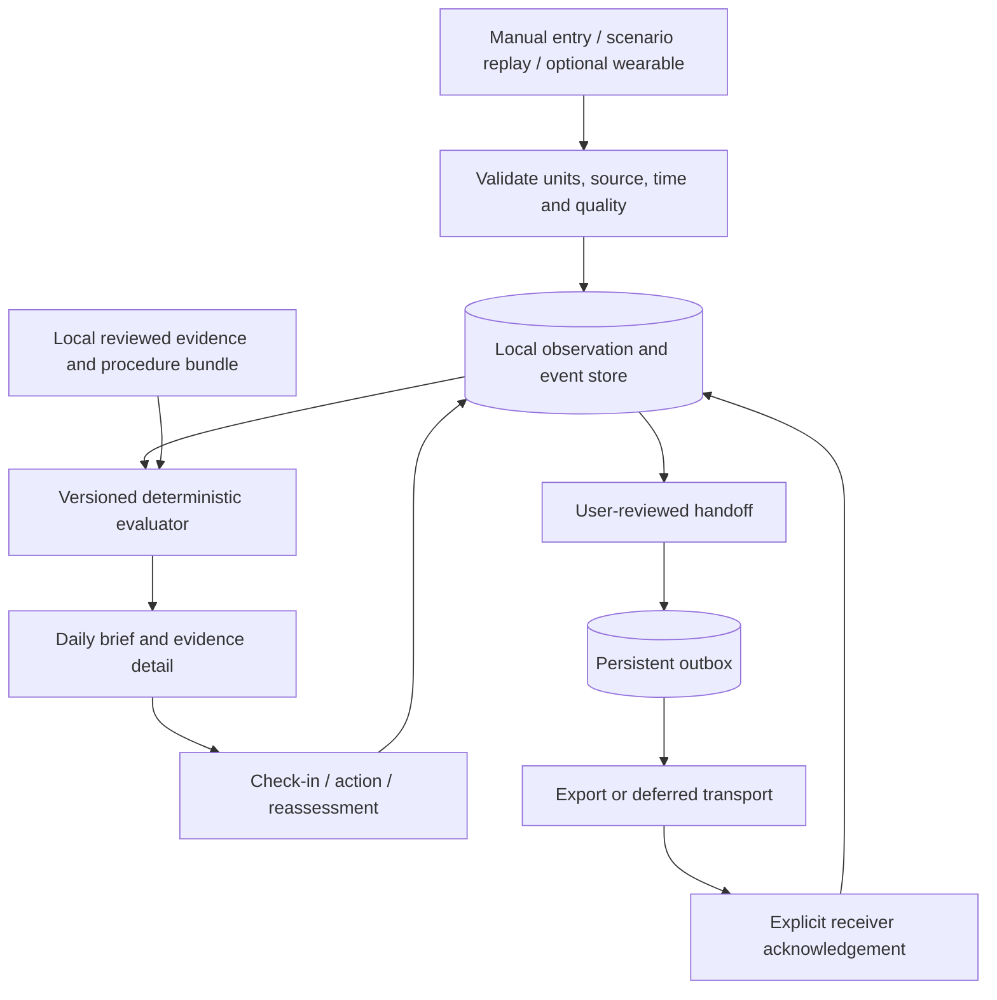

# Tether — product and engineering blueprint

Working name; not approved branding. Prepared October 28, 2026. Android first, with an adaptive iPhone design. This is a proposal and research package, not a completed app. Full challenge/resource verification is still pending; see [research register](RESEARCH.md).

## The product bet

**Help an astronaut turn a change in their health data into a clear next action, even when Earth cannot respond.**

Tether is a personal crew health log with explainable follow-up and a reliable medical handoff. Its defining sequence is **notice → verify → understand → act → reassess**. The daily brief is the entrance, not the whole product.

The strongest competition demonstration is a complete decision under imperfect conditions: the app notices a pattern, refuses to interpret a bad measurement as reliable evidence, records the astronaut's context, and prepares a useful handoff while disconnected. A judge can follow every step and inspect why it happened.

This is a product hypothesis, not a claim of global novelty or a guaranteed award. Existing systems already monitor astronauts and support onboard procedures. The competitive opportunity is the specific workflow, restrained scope, evidence traceability, and verifiable execution. [Prior work and sources](RESEARCH.md).

## Users, situation, and intended use

Primary user: an astronaut using a phone or compact tablet inside a habitat, between scheduled tasks. The proposed daily interaction takes under a minute. That target needs testing; we have not observed an astronaut use it. The first scenario is an exploration mission with an unavailable ground link. It is not an EVA/glove interface, a spacecraft alarm controller, or a hospital chart replacement.

Secondary user: an onboard medical officer who reviews a structured summary. Ground clinicians receive a deferred record when transport is available. A complete ground dashboard is outside the first build.

Intended prototype use: organize observations, demonstrate transparent follow-up rules, support reviewed checklists, and document decisions. It cannot certify fitness for duty, diagnose disease, prescribe medication, measure bone density from a wearable, or autonomously authorize an EVA. Actual care content and clinical thresholds need qualified review.

## What the astronaut can do

### 1. Read a useful daily brief

The first screen answers three questions: What deserves attention? What do I do next? How current are the underlying readings?

Show one highest-priority action, its two most relevant observations, a short care list, and data/connection status. Other issues remain accessible in a ranked list. Never hide a simultaneous urgent issue to preserve a clean screen. Normal data uses restrained treatment; missing data is visibly unknown.

### 2. Inspect the evidence

Every follow-up opens a trace: current value and unit, measurement time, source, quality, comparable historical range, contextual notes, rule version, and known limitations. “Historical range” is not “safe range.” The user can inspect the raw readings behind an aggregate.

The key interaction is **Why this follow-up?** It joins observation → context → rule → next step. An explanation is generated from structured fields and reviewed copy, so it works locally and cannot improvise a diagnosis.

### 3. Complete a short check-in

Capture sleep quality, fatigue, perceived stress, relevant symptoms, and recent exercise context. Offer “Prefer not to answer” for sensitive optional items. Branch only when an answer materially changes the next screen. Save progress locally, allow correction, and label self-report distinctly from sensor measurements.

An urgent symptom route must remain available even if wearables are missing or show a normal-looking value. It opens the locally available, approved crew response pathway; the demonstration must label any unreviewed pathway as simulated.

### 4. Follow and record care tasks

Track the completion of preconfigured mission care tasks, including exercise and scheduled checks. Store completed, skipped, rescheduled, and unable-to-complete separately. Missing a task leads to an appropriate follow-up, not a moralizing streak penalty. The app does not generate a new exercise prescription.

### 5. Prepare a medical handoff

The draft includes concern, onset, relevant changes, symptoms, measurement quality, actions already taken, unresolved questions, and provenance. The astronaut can review included data and exclude optional private notes. An emergency sharing policy is a future mission-level decision, not something the prototype invents.

Save locally first. Offer an export for the demonstration and an explicit queue for a simulated or implemented transport. Display distinct states: Draft → Queued → Transmitted → Received → Clinician reviewed. None implies the next. Do not promise a clinician's response time from a light-time estimate.

### 6. Close the loop

Reassessment is part of the task. Record the repeat reading, changed symptoms, completion outcome, and remaining uncertainty. Acknowledging an alert is not resolving it. Keep the original evidence and subsequent corrections visible in the history.

## Challenge coverage, without fictitious measurement

This matrix maps the supplied summary, not yet the full challenge. P0 is the essential working slice; P1 follows only after P0 passes. A domain being visible does not mean its disease risk has been measured.

| Challenge concern | Gather | Evaluate | Act | Honest first-build coverage |
|---|---|---|---|---|
| Astronaut self-monitoring | Simulated vitals, manual input, structured check-in | Source/quality checks and within-person trends | Repeat measurement, reviewed follow-up, handoff | P0, complete loop |
| Sleep and behavioral wellbeing | Sleep duration, fatigue/stress self-report | Trend and context; missing-answer handling | Check-in, optional private note, reviewed support route | P0; no psychiatric diagnosis |
| Cardiovascular changes | Resting HR; manual BP if available | Comparable resting observations and repeat-reading workflow | Guided verification, local medical review route | P0 HR; BP optional; no event prediction |
| Altered gravity, muscle/bone concerns | Exercise task adherence and symptoms | Identify missed countermeasures; display research context | Log/reschedule preconfigured task, flag review need | P0 basic task log; no measured bone-loss score |
| Immune concerns | Symptoms; explicit lab record if available | Show what is observed and what remains unknown | Reviewed symptom pathway, request medical review | P0 symptom capture; P1 lab imports; no wearable immunity score |
| Radiation | Instrument/environment replay; personal dosimeter only if actually available | Display units, time, source, and gaps separately from personal health | Consult configured mission procedure; record review | P1 bounded real NASA replay; no inferred personal dose |
| Hostile closed environment | Manual contextual note; cabin telemetry adapter later | Keep environmental context distinct from causal inference | Reviewed environmental procedure link | P0 note, P1 telemetry; no invented CO2 sensor |
| Long mission autonomy | Local observations, content, event log | Deterministic local evaluation | Offline check-in, reassessment, handoff queue | P0; airplane-mode proof required |

The full challenge may change priorities. If it explicitly requires a domain/data source absent from P0, promote that work and cut optional polish before increasing total scope.

## Differentiation that judges can inspect

1. **Uncertainty has behavior.** A low-quality or stale sample triggers verification instead of pretending nothing is wrong or manufacturing an alarm from unusable data. A symptom route bypasses that gate.
2. **Every follow-up has a trace.** Show exactly which observations and which rule produced it, and which source informs the background explanation. Separate scientific rationale from an unvalidated prototype parameter.
3. **A medical handoff survives a broken link.** Preserve the draft, its review state, and its provenance through app restarts and reconnects. Demonstrate duplicate-safe retries if a receiver is implemented.
4. **The follow-up ends with a recorded outcome.** Measure whether users can complete the decision, not whether they can stare at a graph.

Avoid claimed clinical outcomes such as “prevents cardiovascular events” or “detects immune suppression.” The claim we can actually test is that participants complete a defined review/handoff task with fewer omissions than a basic readings table.

## Deliberate scope

### P0: finish these before expanding

- One fictional crew profile and one mission context; a separate research replay context.
- Local observation store with timestamps, units, provenance, data-quality states, and corrections.
- Today, Trends, Care, and Log navigation.
- One complete recovery-follow-up flow with check-in, repeat-reading branch, explanation, reassessment, and handoff.
- Urgent-symptom routing demonstrated as a separate fixture, independent of trend rules.
- Offline persistence; readable structured export; explicitly simulated queue/receiver if no transport is built.
- Reviewed-source evidence cards, with prototype rule parameters clearly labeled.
- Three or four deterministic scenarios and meaningful reliability tests.

### P1: strengthen the evidence after P0

- One RadLab historical replay with provenance, units, and coverage gaps.
- One real wearable import path, only if hardware and permissions are available early.
- Basic privacy controls and local access protection; any real-health-data use requires a separate security review.
- Small user study and a qualified mentor review with documented corrections.
- Optional receiver that acknowledges a handoff; not a full ground-control application.

### Defer

Chatbot, medical image analysis, omics prediction model, digital twin, AR anatomy, multi-tenant cloud accounts, clinician portal, push messaging service, continuous background wearable streaming, app-store release, and mission-wide optimization. These consume the same hours needed to make the central loop credible.

## Proposed technical architecture

**Recommendation: Flutter/Dart, local SQLite, a small repository layer, and a pure Dart evaluation module.** Flutter fits the Android-first/shared-mobile requirement and supports platform adaptation. Prefer a framework the team already knows if switching would threaten the demo. The stack is not installed or locked. [Official architecture references](RESEARCH.md#4-engineering-references).

Do not require login, a cloud API, or an LLM to complete core work. Use cached, versioned reference content; refresh it deliberately when connected. State management can use the team's established Flutter approach; select and pin dependency versions at implementation time rather than adding packages speculatively.

Data models:

| Record | Minimum information |
|---|---|
| Observation | ID, crew/context ID, metric, value, unit, observed-at, received-at, source/device/method, quality state, quality reason, synthetic flag, original-record reference |
| Check-in | ID, answers, skipped items, symptom onset, entry time, privacy classification |
| Baseline | Metric, method, mission phase, window, included/excluded observations, sample count, version, review state |
| Follow-up | Rule ID/version, triggering observation IDs, severity, explanation, state, creation/acknowledgement/resolution times |
| Action | Procedure ID/version, intended task, response, completion or skip reason, reassessment link |
| Handoff | Included record IDs, immutable revision, author review time, privacy choices, payload hash, delivery state |
| Outbox event | Handoff revision, idempotency key, attempt count, last error, next retry, receiver acknowledgement |
| Evidence item | Source URL/DOI, title, relevant claim, review date, content version, reuse terms |

Use UTC instants for storage and an explicit mission clock for display. Preserve observed-at separately from import time. Validate units before comparison; quarantine invalid records rather than coercing them silently. Corrections append an amendment and preserve the original. Export a documented JSON schema plus a readable summary; do not claim FHIR compliance without actually implementing and validating a profile.

### Baselines and evaluation

For a prototype, compare equivalent measurement methods under similar conditions. Resting HR must not be compared indiscriminately with exercise HR, and HRV methods such as SDNN and RMSSD must not be interchanged. Maintain preflight and in-flight context separately. Do not constantly absorb deterioration into a rolling baseline.

Illustrative, test-only rule specification: a fixed scenario baseline of 61 bpm, a recent three-observation median at least 10 bpm higher, and two of three nights at least 90 minutes below the scenario sleep baseline produce “Review recovery.” These numbers are authored to exercise software branches; they are **not clinical thresholds or NASA recommendations**. They must remain confined to demo mode unless replaced through qualified review. Use a robust median for comparability, not an unexplained ML risk score.

Evaluation order:

1. Check the urgent symptom/approved critical-condition route independently; never wait for a baseline or a ground reply.
2. Establish whether inputs are compatible, current enough for their intended use, and usable. Freshness is metric-specific, configured, and visible.
3. Require sufficient valid history for a comparative claim. Without it, show “Building your baseline” and retain symptom access.
4. Apply explicit versioned rules and generate a structured explanation.
5. Group related advisory follow-ups; maintain severity ordering. Acknowledgement, snooze, and clinical resolution are separate states.
6. Request a repeat or reviewed action as appropriate and schedule a reassessment. A bad sensor reading must not erase a previously unresolved concern.

Configurable persistence and reset criteria avoid repeated advisories for the same episode. The app must retain an audit trail for threshold changes and baseline resets.

### Connectivity and privacy

Local writes are transactional. Queue a frozen handoff revision only after review. Retrying uses the same idempotency key; a new edit creates a new revision. An HTTP success is not clinician review. A real receiver should acknowledge payload identity and revision. If the receiver is simulated, the demo label must remain visible.

Use synthetic data for the hackathon. For later real use, define device access, OS-backed key storage, vetted database encryption, backup behavior, retention/deletion, and authenticated encrypted transport. Do not invent encryption or equate biometric unlock with encryption. Exclude health content from analytics/crash logs and notification previews. Explain who can see optional behavioral notes before sharing. Preserve revocation state and explain that an already delivered copy cannot be unsent.

Health Connect or a BLE sensor can become the Android adapter; HealthKit is an eventual iOS adapter. Data availability varies by source and permission. Neither a shared UI nor a repository interface proves real integration. iOS build/signing/device verification needs an appropriate Apple build environment; Windows alone is not an iPhone validation plan.

## Demo story

**A synthetic astronaut is on mission day 42. Ground contact is unavailable. Their recent sleep is shorter and resting HR has changed.**

1. Today shows “Check your recovery,” not a diagnosis or a health score.
2. Tap Review changes. Inspect the two observations, their source, historical comparison, and explanation.
3. Switch to a poor-quality repeat-reading fixture. The app asks to verify the reading; it does not claim that the astronaut is healthy because a measurement is missing.
4. Complete the check-in and a simulated verification step; select the appropriate reviewed/demo pathway. Record the outcome.
5. Prepare a handoff. Inspect included data, exclude a private note, queue, close the app, reopen, and prove the record remains available offline.
6. If a receiver exists, reconnect and show its acknowledgement without implying clinician review. Otherwise export the record and explicitly call transport simulated.
7. Open a separate real NASA environment replay to show data provenance and the boundary between environmental telemetry and personal measurements.

Target a 2–3 minute rehearsal, subject to the actual presentation rules. Keep a short offline screen recording as a fallback. The strongest moment is the system behaving correctly when data or connectivity is imperfect.

## Validation and success criteria

These are proposed acceptance targets, not measured results:

- At least four of five formative testers identify the highest-priority action within 10 seconds without coaching.
- At least four of five complete the nonurgent check-in in 60 seconds and prepare the handoff in 90 seconds.
- Testers can correctly explain both “historical range is not a clinical limit” and “queued is not reviewed.” Record misunderstandings and revise copy.
- Compare the same task with a simple vitals table: counterbalance task order, record omissions/time, and report individual results. Five users provide formative evidence, not statistical or clinical validation.
- Core flow works in airplane mode and survives forced restart after local save and after queueing.
- Rule fixtures cover insufficient history, stale data, artifact, trend change, urgent symptoms despite normal vitals, duplicate imports, unit mismatch, and unresolved concern after a failed repeat.
- Accessibility check on Android: screen reader order, large text, 48dp targets, contrast, reduced motion, system Back, and keyboard/inset behavior. Test iOS later on actual Apple tooling; a picture is not verification.
- A qualified reviewer evaluates claims, intended use, demo parameters, escalation copy, and evidence mapping. Record which items remain unreviewed if no reviewer is available.

## Competition strategy

| Planning lens | Evidence to put in front of judges |
|---|---|
| Impact | A specific communication-limited decision task, reduced omissions in a small usability test, and a plausible remote-care extension hypothesis |
| Creativity | An integrated evidence/quality/action/reassessment loop with visible state transitions |
| Validity | Clear boundaries, source registry, real-data provenance, review notes, and deterministic test results |
| Relevance | The gather/evaluate/act mapping plus explicit treatment of the supplied health concerns |
| Presentation | One concise scenario, readable phone UI, offline demonstration, and transparent limitations |

No numeric weights or global award category are assumed. Treat the final 2026 judging guide as authoritative once verified.

## Open decisions and next gate

Confirm the full statement and current preparation rules; identify team capacity and hardware; test dataset access; review the proposed visual direction; then lock the smallest vertical slice. Maintain the app's actual status honestly at every milestone: planned, implemented, device-tested, user-tested, clinically reviewed are separate claims.
